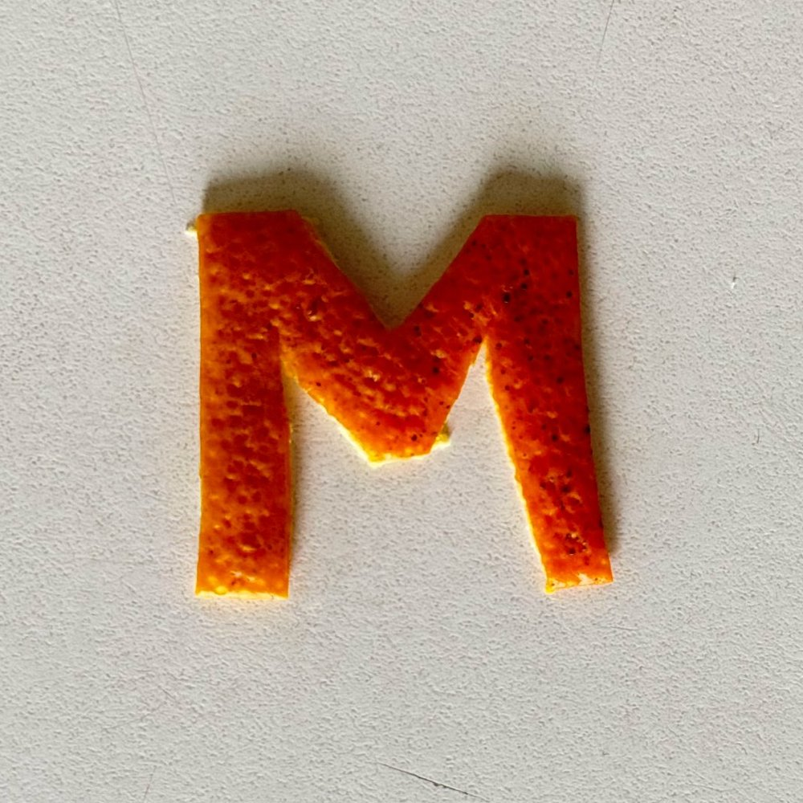

# Letterform and Haiku

## Letterform

## Haiku

Fingers sink in peel  
then a cold winter breeze blew  
Xmas I can feel

## Process

[See how the mandarin letter was made, from first sketches to the final cut](process.html)

---

Letterform: Sans AI. Haiku: AI-assisted (my own Slovak draft, translated and shortened with AI). Page structure and alt text: AI-assisted.
