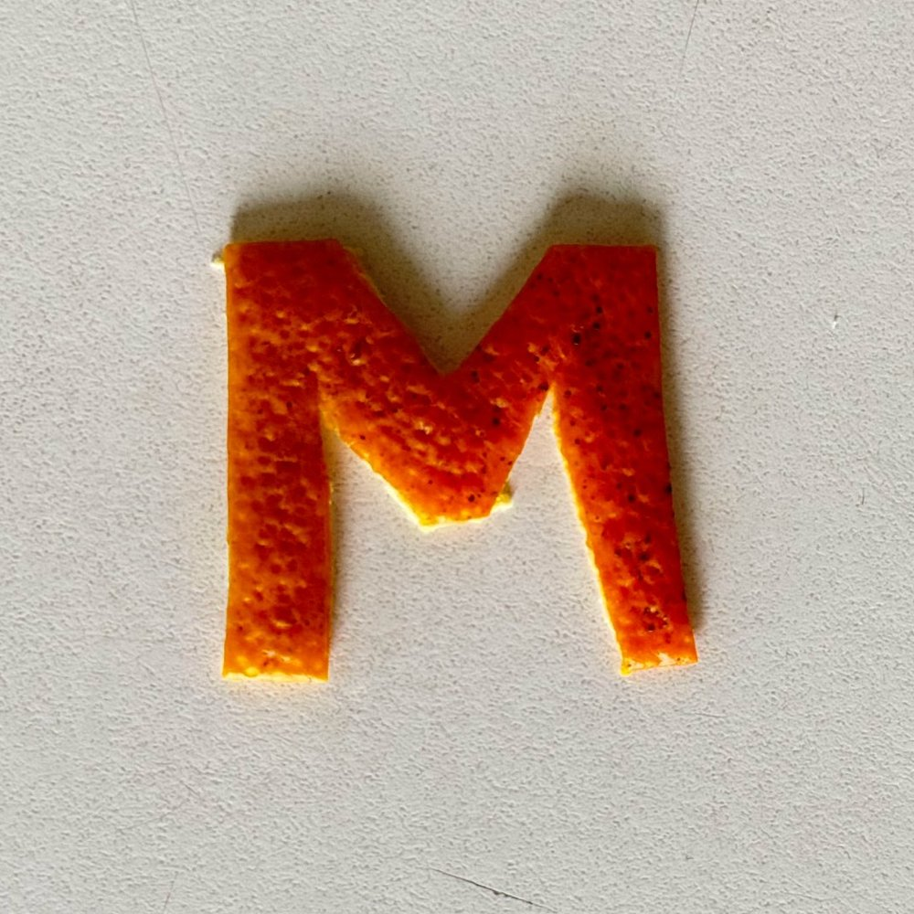
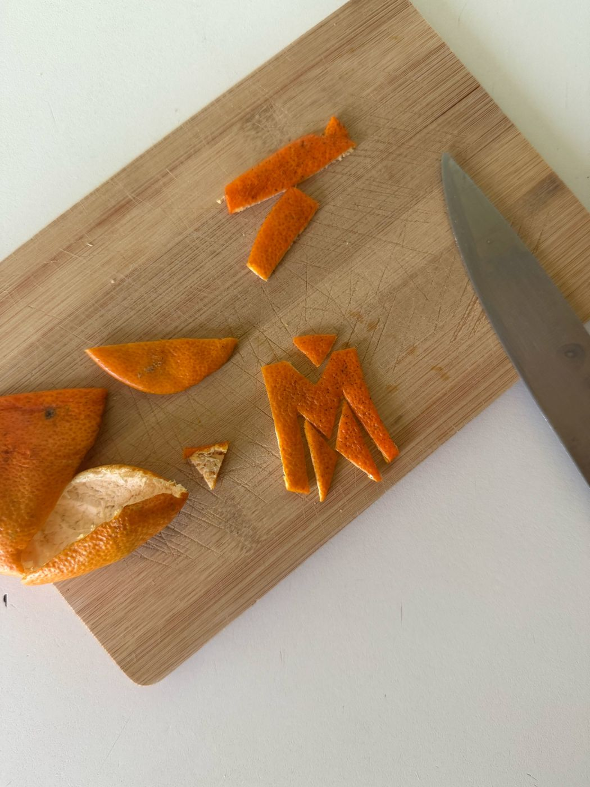

# Process: A Letter Cut from Mandarin Peel

Every winter my kitchen fills up with mandarins. I love their taste, their smell and that strong orange colour, so I decided to make my letter out of their peel.

## Why mandarins?

For me, mandarins are the taste and smell of winter. Instead of choosing a material only for how it looks, I wanted one that I enjoy with all my senses. The peel is soft, a little oily, and very orange, and it changes as it dries, so the letter is never quite finished.

## Why the letter M?

My name, Matúš, starts with M, so it felt natural to make a letter that is personal to me. Its strong vertical strokes and the V in the middle are also simple enough to cut from small pieces of peel.

## 1. Sketches on paper

I started by drawing the letter many times on paper to find a shape simple enough to cut from small pieces of peel. Thin details and sharp corners were hard to keep, so I chose wider strokes and rounder joints.

## 2. Peeling and testing the material

I peeled several mandarins and tried different ways: one long spiral, larger pieces, and small pieces. I tested how the peel bends, how easily it tears and how it behaves when I press it flat.

## 3. Cutting the strokes

I flattened the peel and cut the strokes of the letter with a knife and scissors, following a paper template. The outer skin is quite firm, but the white inner layer tears easily, so I had to cut slowly.

## 4. Iterations

Each version taught me something about the material.

1. First version: description of what happened.
2. Second version: what you changed.
3. Third version: what you changed.

## 5. Drying and the changing letter

After a few hours the peel started to dry, shrink and curl at the edges. The colour got deeper and the letter slowly changed shape. I photographed it at different stages to keep a record of how the material lives on its own.

## 6. The final letterform

- **Material:** fresh mandarin peel
- **Tools:** knife, scissors, paper template
- **Technique:** peeling, flattening, cutting, arranging
- **Size:** about X cm

## What I learned

Working with food meant working with time. The peel kept drying and changing, so I had to make decisions quickly and photograph every step. I also learned that a material chosen for its smell and taste can shape a letter as much as a pen or a computer can.

---

## Haiku drafts

### First draft

My fingers sank into the mandarin  
then the winter breeze blew  
I love this time, Christmas and all

### What I changed

My first draft was too long for the 5–7–5 pattern, so I shortened the first line to focus only on my fingers sinking into the peel. I added "cold" to make the winter feeling stronger. I also rewrote the last line: instead of just saying that I love this time of year, it now says that I can feel Christmas.

### Final version

Fingers sink in peel  
then a cold winter breeze blew  
Xmas I can feel

[See the final haiku with the letterform](./)

## Alternate alt text

- **Detail:** A letter M made of mandarin peel, its dimpled orange skin and pale white inner layer visible along the cut edges.
- **Mood:** A small, bright orange letter that looks warm and playful, like a winter snack turned into type.
- **Material:** A letter shaped from soft, slightly oily citrus peel that curls and darkens as it dries.

## References

- Paul Rand, "Design and the Play Instinct": play and experimentation as part of the design process.
- Reference 2: short note.

[Back to Letterform and Haiku](./)

---

Letterform: Sans AI. Haiku: AI-assisted (my own Slovak draft, translated and shortened with AI). Process text: AI-generated from my own notes and edited by me.
