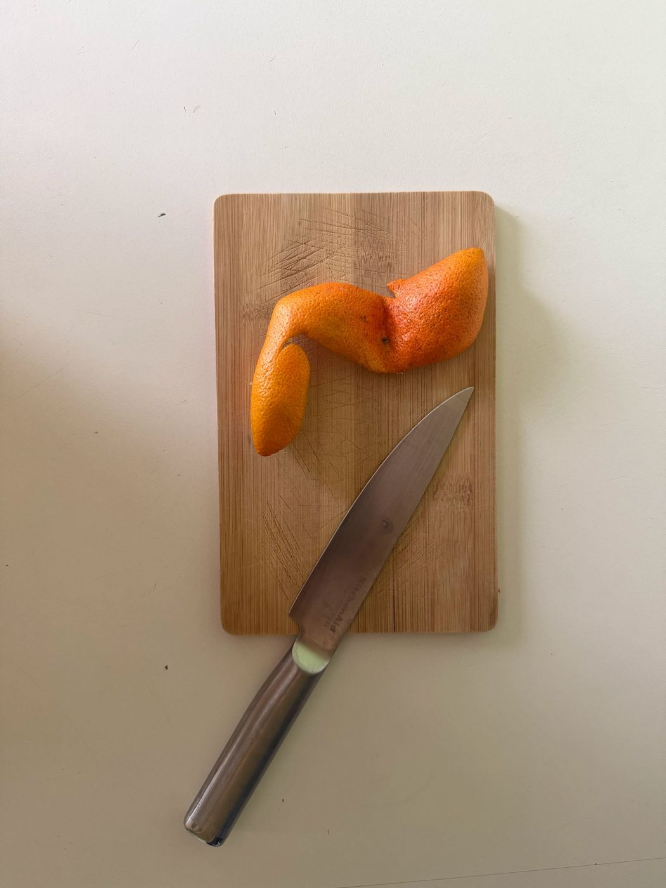
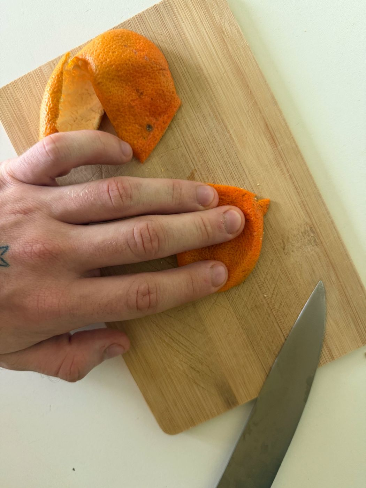
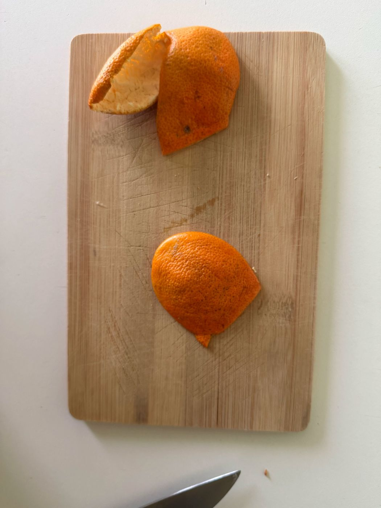
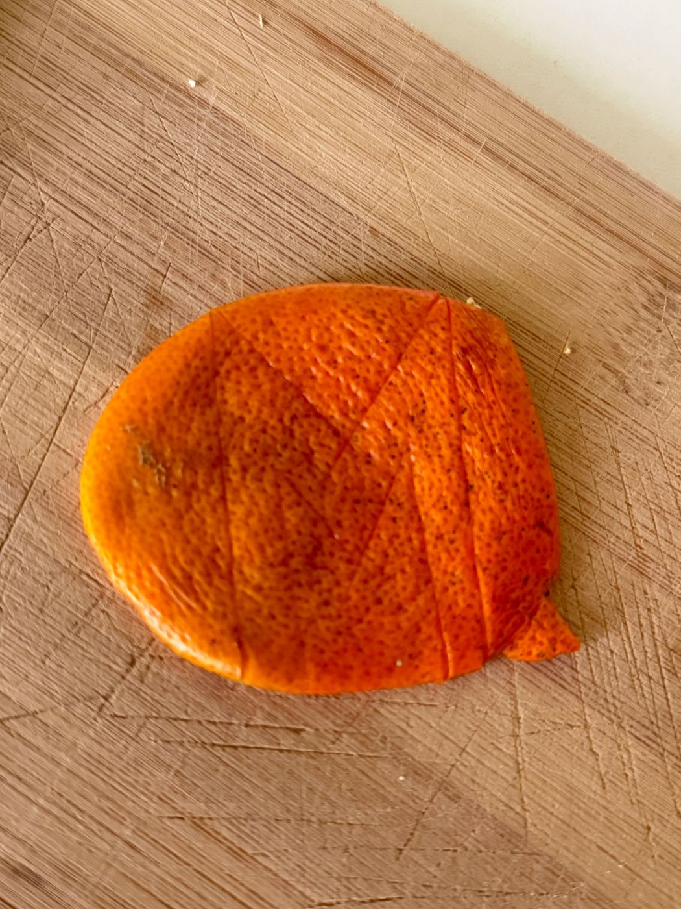
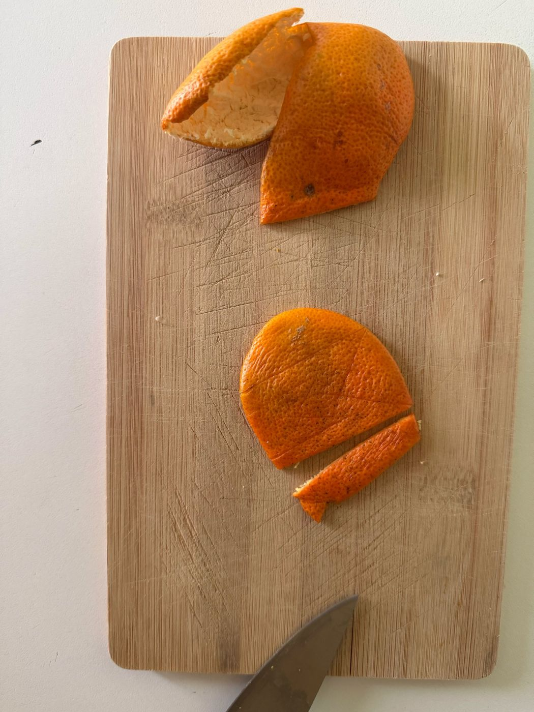
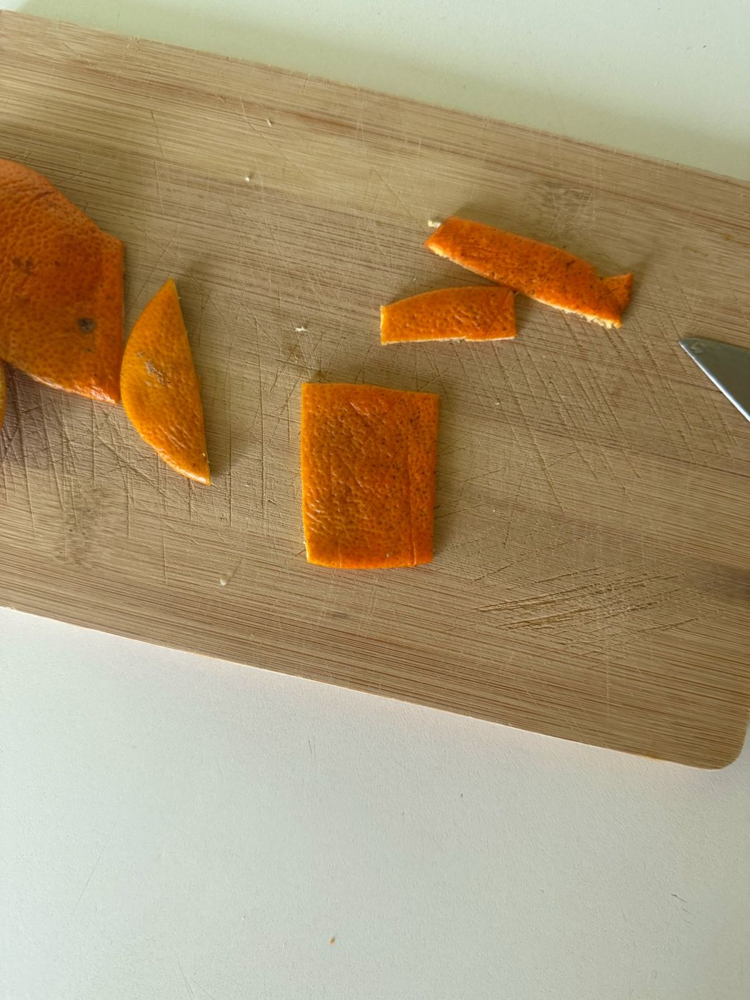
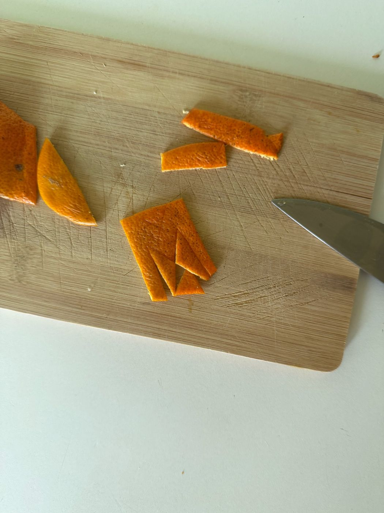
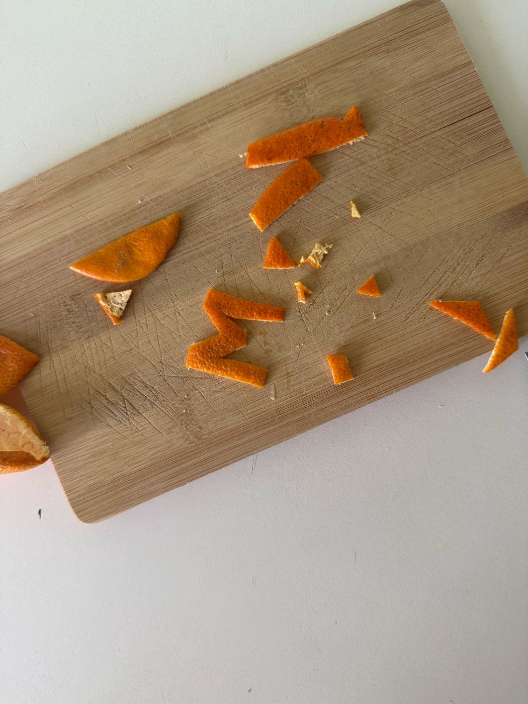

# Process: A Letter Cut from Mandarin Peel

Every winter my kitchen fills up with mandarins. I love their taste, their smell and that strong orange colour, so I decided to make my letter out of their peel, using only a knife and a cutting board.

## Why mandarins?

For me, mandarins are the taste and smell of winter. Instead of choosing a material only for how it looks, I wanted one that I enjoy with all my senses. The peel is soft, a little oily and very orange, with a dimpled texture that stays visible even in a small letter.

## Why the letter M?

My name, Matúš, starts with M, so it felt natural to make a letter that is personal to me. Its strong strokes and the V in the middle are also simple enough to cut from a small piece of peel.

## 1. Peeling

I started with a whole peel. It came off the fruit in one curved, twisted piece, which showed me straight away that the material does not want to be flat.

## 2. Flattening the peel

To get a surface I could cut, I pressed the peel flat with my fingers and cut away the most curved parts.

## 3. Drawing into the peel

Instead of sketching on paper, I drew the shape of the M directly into the peel by lightly scratching the skin with the tip of the knife. These thin lines became my guide for cutting.

## 4. Cutting the base

I cut off a strip from the edge and trimmed the peel into a small rectangle, so I had a clean block to cut the letter from.

## 5. Iterations

1. **First version:** I cut the M straight out of the rectangle. Notes on what happened.
2. **Second version:** I separated the strokes from the leftover peel. Notes on what happened.
3. **Third version:** I arranged the strokes again and adjusted their angles. Notes on what happened.

## 6. The final letterform

For the final version I moved the letter from the cutting board onto a clean white surface, so only the orange shape and the texture of the peel stay visible.

- **Material:** fresh mandarin peel
- **Tools:** kitchen knife, cutting board
- **Technique:** peeling, flattening, scratching the outline, cutting

## What I learned

The peel was not an easy material. It curves, tears and is different in every place, so I could not plan everything in advance. I had to react to the material, and the letter changed with every try. I also learned that a material chosen for its smell and taste can shape a letter as much as a pen or a computer can.

---

## Haiku drafts

### First draft

My fingers sank into the mandarin  
then the winter breeze blew  
I love this time, Christmas and all

### What I changed

My first draft was too long for the 5–7–5 pattern, so I shortened the first line to focus only on my fingers sinking into the peel. I added "cold" to make the winter feeling stronger. I also rewrote the last line: instead of just saying that I love this time of year, it now says that I can feel Christmas.

### Final version

Fingers sink in peel  
then a cold winter breeze blew  
Xmas I can feel

[See the final haiku with the letterform](./)

## Alternate alt text

- **Detail:** A letter M made of mandarin peel, its dimpled orange skin and pale edges visible along the cuts.
- **Mood:** A small, bright orange letter on white, warm and playful, like a winter snack turned into type.
- **Material:** A letter shaped from soft, slightly oily citrus peel, cut by hand with a kitchen knife.

## References

- Paul Rand, "Design and the Play Instinct": play and experimentation as part of the design process.

[Back to Letterform and Haiku](./)

---

Letterform: Sans AI. Haiku: AI-assisted (my own Slovak draft, translated and shortened with AI). Process text: AI-generated from my own notes and photos, edited by me.
